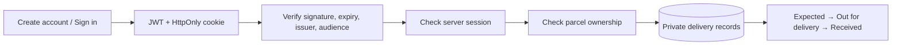

<div align="center">
  
  <h1>PARCELPASS</h1>
  <p><strong>Every arrival. Accounted for.</strong></p>
  <p>A private delivery command center.<br>Log what’s on its way. Keep your arrivals in view. Own your delivery history.</p>
  <p><a href="#the-experience">Explore the experience</a> · <a href="#run-locally">Run locally</a> · <a href="#api-reference">API reference</a></p>
  <p> </p>
</div>

## The experience

ParcelPass gives personal deliveries a focused home. Its flight-console layout pairs a floating, layered arc reactor with a live arrival summary and a horizontal shipment manifest. Cyan illumination, brushed-metal rings, angular controls, and a compact command dock create a distinct visual system.

- **Private locker:** register, sign in, update your name, change your password, and securely sign out.
- **Complete parcel lifecycle:** create, inspect, edit, and delete shipments; move parcels through Expected, Out for delivery, and Received.
- **Delivery history:** received parcels retain their receipt date and stay searchable.
- **Find an arrival:** search titles, couriers, tracking references, and notes; filter by activity or sort by arrival date, newest, or name.
- **At-a-glance overview:** active parcels, out-for-delivery count, received count, and overdue expected dates.
- **Take your records with you:** export the full manifest as a spreadsheet-friendly CSV.
- **Made for different screens:** a detailed desktop manifest becomes a readable shipment list on phones.
- **Your atmosphere:** persistent light/dark themes, a pause-animation control, and system reduced-motion support.
- **A clear first visit:** explicitly labelled sample parcels demonstrate the interface without creating an account or mixing sample data into a real locker.
- **Account control:** permanently remove an account and its parcels from Account settings after password confirmation.

ParcelPass is a personal record keeper. Courier names and tracking numbers are stored for reference. Delivery dates and status changes are entered by the user; the app does not query couriers or provide automatic tracking updates.

## Technology

<p align="center">
  
</p>
<p align="center">
  
  
  
</p>

| Area | Implementation |
| --- | --- |
| Frontend | Semantic HTML, custom CSS, vanilla JavaScript, native dialogs |
| Visual system | CSS 3D transforms, SVG, layered gradients, self-hosted Sora and Chakra Petch |
| Backend | Node.js 24, Express 5 |
| Authentication | jsonwebtoken, bcryptjs, server-side session records |
| Data | PostgreSQL in production; built-in SQLite for local development |
| Validation & protection | Zod, Helmet, express-rate-limit, origin checks |
| Verification | Node test runner, Supertest, Playwright, GitHub Actions |

## Run locally

Install **Node.js 24 LTS** and npm. No local database server is required.

```bash
git clone https://github.com/rachit1807/parcelpass.git
cd parcelpass
npm ci
cp .env.example .env
node -e "console.log(require('node:crypto').randomBytes(48).toString('hex'))"
```

Copy the generated value into `JWT_SECRET` in `.env`, then start the application:

```bash
npm run dev
```

Open **http://localhost:3000**. Create your own account; no shared login or default password is included. Local accounts and parcels are saved in the ignored `data/parcelpass.db` SQLite file.

### Configuration

| Variable | Purpose |
| --- | --- |
| `PORT` | Listening port; defaults to `3000` |
| `JWT_SECRET` | Required; a cryptographically random value of at least 32 characters |
| `JWT_EXPIRES_IN` | Session lifetime; defaults to `30m` |
| `APP_ORIGIN` | Exact app origin, without a trailing slash; e.g. `http://localhost:3000`. Required HTTPS origin in production |
| `DATABASE_URL` | PostgreSQL connection URL. Optional locally; mandatory in production |
| `NODE_ENV` | Set to `production` when hosted to enable Secure cookies and production validation |

The database connection uses the TLS parameters supplied by the database provider. Keep certificate verification enabled. Tables and indexes are created on startup; the database role needs schema creation privileges. Secrets and local databases are excluded from Git.

### Commands

| Command | Purpose |
| --- | --- |
| `npm run dev` | Start with automatic reload |
| `npm start` | Start the application |
| `npm run check` | Verify server and client JavaScript syntax |
| `npm test` | Run 18 API/security integration checks |
| `npx playwright install chromium` | Install the browser for end-to-end checks |
| `npm run test:e2e` | Run responsive and full account/parcel workflows against a running app |

## How it works



Every protected request verifies the JWT and its persistent session record. Parcel queries include the authenticated owner ID. Updates carry a version number to prevent an old browser window from silently overwriting newer changes.

## API reference

All request bodies are JSON. Successful registration/login sets the session cookie and returns `{ user, expiresAt }`. JWTs are not returned in response bodies or stored in browser local storage. API clients can use a cookie jar; protected endpoints also support `Authorization: Bearer <valid JWT>` when a client already holds a valid session token.

| Method | Endpoint | Access | Behavior |
| --- | --- | --- | --- |
| GET | `/api/health` | Public | Database readiness check |
| POST | `/api/auth/register` | Public | Create account and session |
| POST | `/api/auth/login` | Public | Verify credentials and start session |
| GET | `/api/auth/me` | Signed in | Verify token/session and read profile |
| POST | `/api/auth/logout` | Signed in | Revoke current session |
| PATCH | `/api/auth/profile` | Signed in | Update display name |
| PATCH | `/api/auth/password` | Signed in | Change password and revoke all sessions |
| DELETE | `/api/auth/account` | Signed in | Confirm password and delete account/data |
| GET | `/api/parcels` | Signed in | List only the current user’s parcels |
| POST | `/api/parcels` | Signed in | Create a parcel |
| PATCH | `/api/parcels/:id` | Owner | Edit a parcel with version check |
| DELETE | `/api/parcels/:id` | Owner | Delete a parcel |

### Try the complete flow

Create an account and save the session cookie:

```bash
curl -c cookies.txt http://localhost:3000/api/auth/register \
  -H 'Content-Type: application/json' \
  -d '{"name":"Alex Morgan","email":"alex@example.com","password":"ChooseYourOwn123!"}'
```

Create a shipment:

```bash
curl -b cookies.txt http://localhost:3000/api/parcels \
  -H 'Content-Type: application/json' \
  -d '{"title":"Studio headphones","courier":"Blue Dart","tracking":"BD123456","expected_date":"2026-11-02","status":"expected","notes":"For the home studio"}'
```

Read your private manifest:

```bash
curl -b cookies.txt http://localhost:3000/api/parcels
```

Update a parcel with its current `version` and complete fields:

```json
{
  "title": "Studio headphones",
  "courier": "Blue Dart",
  "tracking": "BD123456",
  "expected_date": "2026-11-02",
  "status": "received",
  "notes": "Arrived safely",
  "version": 1
}
```

A successful update increments `version`; marking Received records `received_at`. Moving back to another status clears that receipt date. Status values are `expected`, `out_for_delivery`, and `received`.

Profile update accepts `{ "name": "Alex Morgan" }`. Password change accepts `{ "currentPassword": "...", "newPassword": "..." }`. Account deletion accepts `{ "password": "..." }`.

Errors return `{ "message": "..." }`: `400` invalid input, `401` missing/expired/revoked session or invalid credentials, `403` disallowed origin, `404` missing/non-owned resource, `409` duplicate email or stale update, and `429` throttling. Create operations return `201`; successful deletes return `204` for parcels and `200` for accounts.

### Validation

- Names: 2–70 characters; emails are trimmed and normalized to lowercase.
- Passwords: 10–72 characters, no more than 72 UTF-8 bytes, with uppercase, lowercase, and a number.
- Parcel title: 2–100 characters; courier: 2–50; tracking reference: up to 100; notes: up to 1,000.
- Expected date: a real calendar date between 2000 and 2100.

## Security & privacy

Passwords use bcrypt with 12 rounds. JWT verification fixes HS256, issuer, and audience. Production cookies are Secure, HttpOnly, and SameSite=Strict. Server-side sessions allow immediate revocation at sign-out; changing a password revokes all sessions.

The API uses parameterized SQL, ownership checks, body size limits, security headers, a restrictive content security policy, same-origin write checks, and request throttling. User text is escaped before rendering. CSV exports guard against spreadsheet formula injection. No external scripts, analytics, or frontend font requests are required.

Public registration does not verify email ownership. Password recovery and courier API integrations are not included. This app is intended for personal parcel records, not storing delivery access codes or payment data.

## Deployment

Host the Node service with `npm ci` as the build command and `npm start` as the start command. Use Node.js 24, configure `/api/health` as the HTTP health path, and set all production variables listed above.

Use a **dedicated persistent PostgreSQL database**. The application intentionally refuses to start in production without `DATABASE_URL`; it does not silently put production accounts on an ephemeral filesystem. Keep backups appropriate to your chosen database plan. Provider quotas, billing, and availability remain subject to that provider’s plan.

The server listens on `0.0.0.0` and respects the platform `PORT`. SIGTERM/SIGINT close the HTTP server and database connections gracefully.

## Project structure

```text
public/                 Interface, reactor artwork, self-hosted fonts
src/app.js              Express routes, validation, auth, ownership checks
src/db.js               PostgreSQL / SQLite adapter and schema
src/server.js           Configuration, startup, graceful shutdown
tests/api.test.js       API and security integration tests
tests/browser/          Responsive and lifecycle browser checks
docs/                   Visual evidence and verification notes
.github/workflows/      Continuous integration
```

## Author & license

**Rachit Tripathi** · [GitHub](https://github.com/rachit1807)

MIT licensed. Self-hosted Sora and Chakra Petch fonts include their SIL Open Font License files in `public/fonts/`. The reactor is original CSS/SVG artwork inspired by cinematic engineering interfaces; this project is independent and is not affiliated with Marvel or Microsoft.
